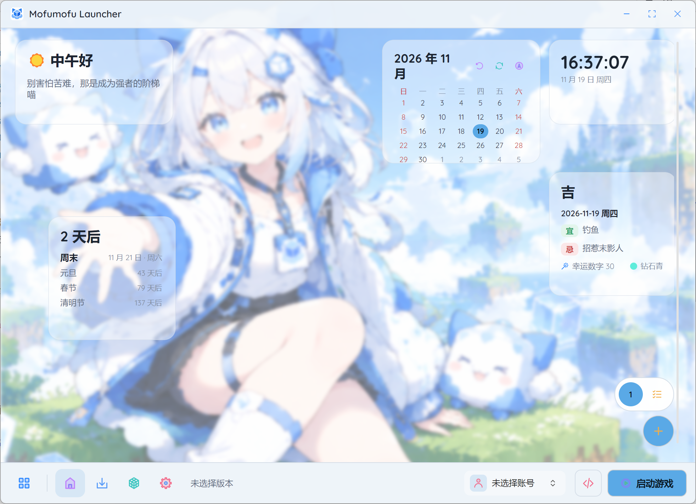
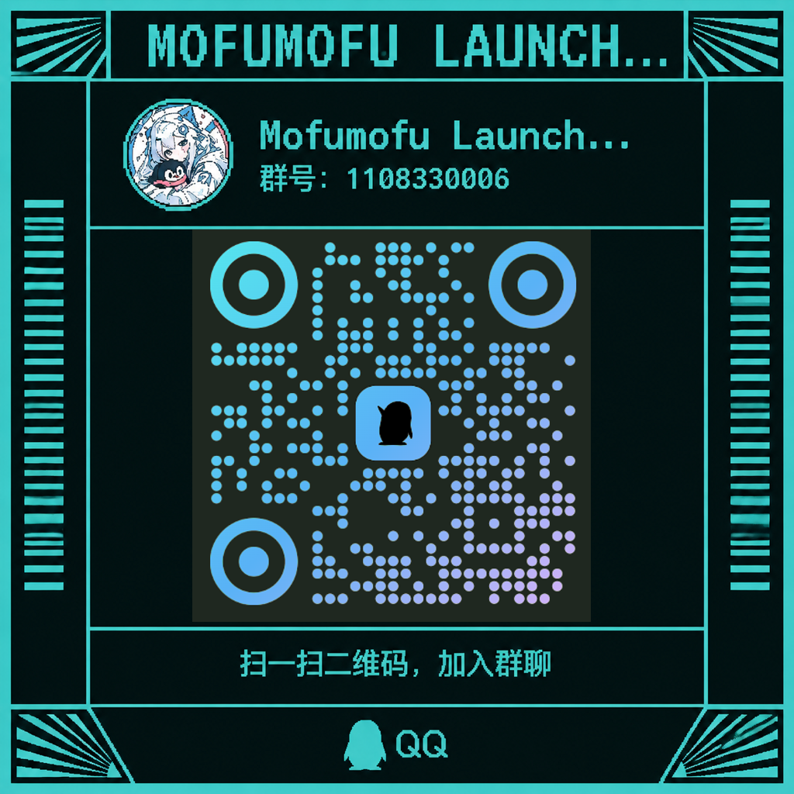

# Project Mofumofu

> **为自由而生。**<br>
> [](https://github.com/redstore-noob/Mofumofu/stargazers)[](https://github.com/redstore-noob/Mofumofu/issues)[](https://github.com/redstore-noob/Mofumofu/forks)[](LICENSE)

## 项目相关

**项目不是一个纯粹的Minecraft启动器或是其他工具，它更像是一整套关于Minecraft的实用工具，以Mofumofu Launcher为中心。**
目前项目已有的组成部分有:

- `MofuCore` -> 一个基于`.NET 10`的Minecraft启动器类库，可以快速构建一套好用的Minecraft启动器
- **`Mofumofu.Launcher`** -> 基于`MofuCore`+`Avalonia`构建，支持插件系统，桌面自定义小组件等特色功能。

## Mofumofu Launcher




### 特色功能

- 开服面板集成：以服务器插件+启动器的新架构管理服务器，支持VPS和面板服

- 插件系统：让你的启动器更多彩！

- 桌面小组件系统：随便摆，配上插件系统带来无限可能。


### 项目结构

项目目前跨的技术栈十分的多，代码量相对庞大，所以贡献者与参阅者可能会面对同时看到.NET与Java代码的问题。

| 组件                                 | 目标框架          | 需要安装     | 说明                                                           |
| ------------------------------------ | ----------------- | ------------ | -------------------------------------------------------------- |
| `Mofumofu.Launcher`                  | `net10.0`         | .NET 10 SDK  | 主启动器（Avalonia UI），日常开发入口                          |
| `MofuCore`                           | `net10.0`         | .NET 10 SDK  | 启动器核心类库，可脱离 UI 单独复用                             |
| `Mofumofu.ExtensionAPI`              | `net10.0`         | .NET 10 SDK  | 插件 API，开发插件只需引用它                                   |
| `Mofumofu.RemoteProtocol`            | `net10.0`         | .NET 10 SDK  | 启动器与 ServerAgent 的通信协议                                |
| `Mofumofu.ServerAgent`               | `net10.0`         | .NET 10 SDK  | VPS 服务端 Agent（ASP.NET Core）                               |
| `Mofumofu.Console`                   | `net10.0`         | .NET 10 SDK  | 终端界面版本，程序集名为 `Mofumofu.TUI`                        |
| `Mofumofu.Extension.LogshareService` | `net10.0`         | .NET 10 SDK  | 官方插件示例：崩溃日志分析                                     |
| `NekoSolo`                           | `net10.0-windows` | .NET 10 SDK  | 自解压安装器，**仅 Windows 可构建**                            |
| `Mofumofu.NekoProbe`                 | Java 21           | **Java 21+** | Paper 服务端插件，用仓库自带的 `gradlew` 构建                  |
| `tests/*`                            | `net10.0`         | .NET 10 SDK  | xUnit 测试（Launcher / RemoteProtocol / ServerAgent 三个项目） |


### 项目构建

> 构建前确保电脑中至少有.NET10+SDK，如果你需要构建所有组件，你可能还需要Java 21+。

```bash
dotnet run --project Mofumofu.Launcher/Mofumofu.Launcher.csproj #just Launcher


cd Mofumofu.NekoProbe #当你需要构建服务器插件时
./gradlew build          # Windows: gradlew.bat build
```


## 贡献者名单

> 项目初起步，贡献者数量较少，后续可能会有单开的md文件写上这些名字。

[hacker1232345](https://github.com/hacker1232345)

## 项目相关链接💥


[项目官网(目前)](https://redstore-noob.github.io)
