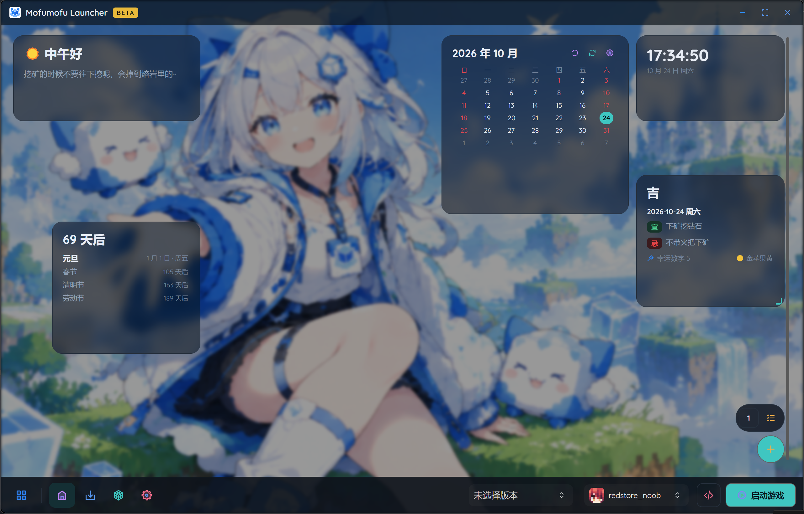
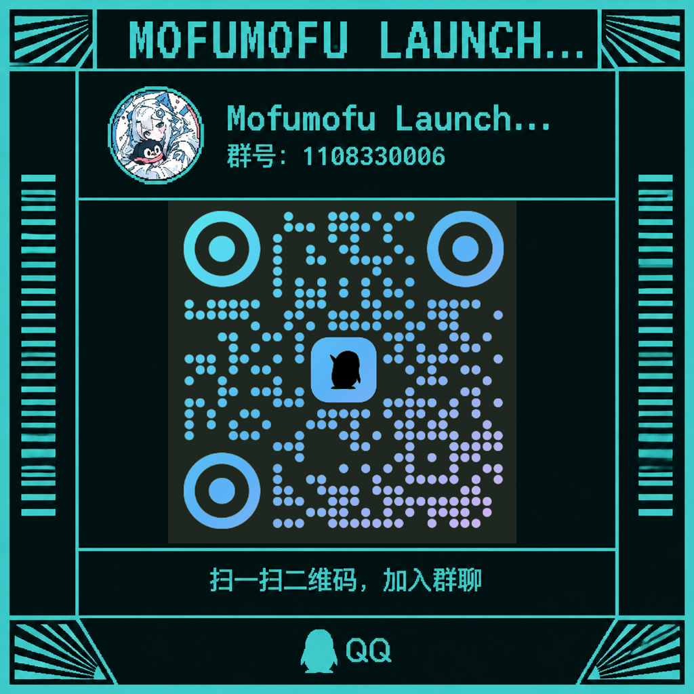

# Project Mofumofu
> 基于.NET10+AvaloniaUI的Minecraft Launcher，为自由而生。
[](https://github.com/redstore-noob/Mofumofu/stargazers)
[](https://github.com/redstore-noob/Mofumofu/issues)
[](https://github.com/redstore-noob/Mofumofu/forks)


## 免责声明
> [!CAUTION]
> 本软件不包含任何与中华人民共和国宪法相抵触的内容，本人完全支持中国共产党领导，软件中不含有任何试图对社会主义进行颠覆、与社会主义制度相忤逆的内容。软件无商业用途，原则上不支持中国大陆用户使用，与Mojang Studios，Microsoft与NetEase, Inc.无任何关联，未对这些公司的利益进行损害等。
更多免责声明请参考[免责声明](docs/免责声明.md)

## 项目介绍

项目基于`.NET10+Avalonia`，为创作者提供了一套便携的工具，为喜欢客制化的人同样提供了高度自定义的主页小组件网格摆放+插件系统。
爆炸性的创新功能:
- Rewind备份系统:支持不同时间点对存档进行快照保存，当存档损坏/不甘心时即可回档到从前。支持定时备份、备份分类、安全备份。
- 插件系统:啥都能扩展，自由是你的。
- 音乐播放器:支持直连网易云音乐账号，支持本地音乐文件播放，现代化的流畅界面。
- NekoSolo安装:整合包分发新方式，一个exe全自动。
- 开服:强大的服务器开服功能，跟你口袋里的服务器面板一样好用。



## 构建项目
```bash
git clone https://www.github.com/redstore-noob/Mofumofu #拉取一些仓库

dotnet build Mofumofu.slnx -c Release
```

## 相关文档
[免责声明](docs/免责声明.md)
[插件开发文档](docs/Extension_Guide/overview.md)

## 项目相关链接💥
  
[项目官网(目前)](https://redstore-noob.github.io)